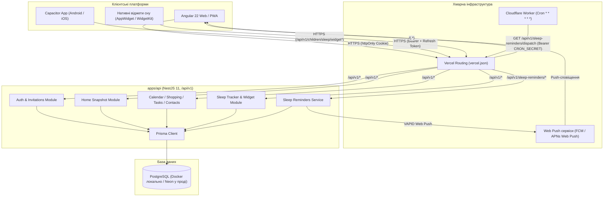
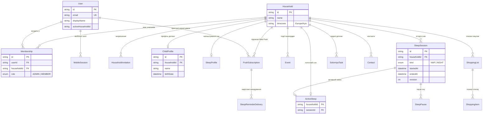
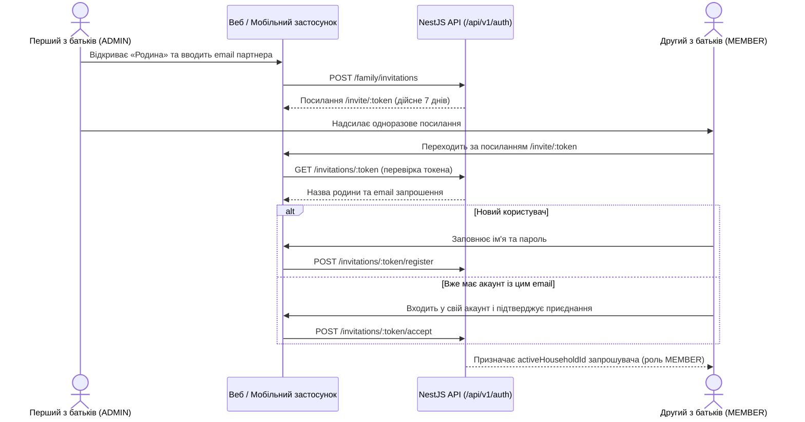
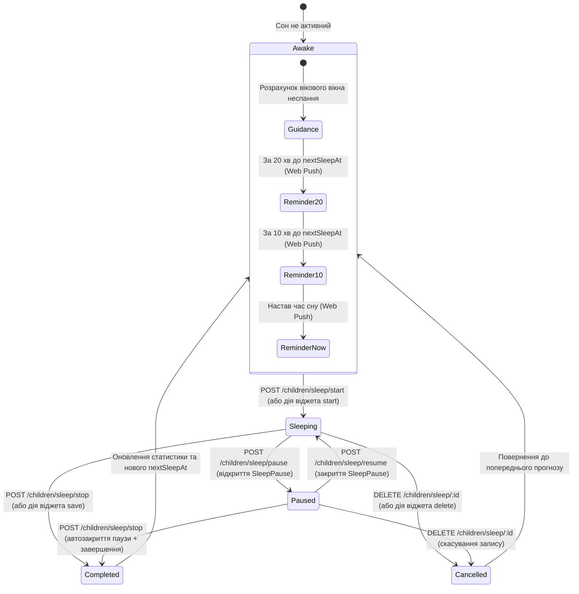

# protsenkoHub

**protsenkoHub** — сімейний хаб для двох батьків: спільний календар, списки покупок, задачі дитини, трекер сну з прогнозами та нагадуваннями, важливі контакти й керування родиною. Усі дані належать спільному домогосподарству (`Household`), синхронізуються між пристроями в реальному часі та доступні у вебверсії, встановленому PWA і мобільних застосунках Android та iOS із нативними віджетами сну.

---

## Зміст

- [Можливості продукту](#можливості-продукту)
- [Технологічний стек](#технологічний-стек)
- [Архітектура системи](#архітектура-системи)
- [Модель даних](#модель-даних)
- [Структура репозиторію](#структура-репозиторію)
- [Швидкий старт](#швидкий-старт)
- [pgAdmin у Docker](#pgadmin-у-docker)
- [Два акаунти в одній родині](#два-акаунти-в-одній-родині)
- [Трекер сну, PWA-нагадування та віджети](#трекер-сну-pwa-нагадування-та-віджети)
- [Мобільні застосунки (Android та iOS)](#мобільні-застосунки-android-та-ios)
- [Екрани та API](#екрани-та-api)
- [Продакшен на Vercel і Neon](#продакшен-на-vercel-і-neon)
- [Команди та перевірка](#команди-та-перевірка)
- [Пов'язана документація](#повязана-документація)

---

## Можливості продукту

- **Головна панель (`/app/home`)** — зведений огляд дня: активний або останній сон дитини, найближчі події календаря, відкриті задачі та активні покупки.
- **Календар (`/app/calendar`)** — сімейні події з прив'язкою до учасника родини, нотатками, періодичністю, відмітками про виконання та м'яким видаленням.
- **Покупки (`/app/shopping`)** — декілька іменованих списків покупок, позиції з кількістю, одиницями виміру, категоріями та відмітками про купівлю.
- **Задачі дитини (`/app/children`)** — задачі з пріоритетами («Звичайний», «Важливо», «Терміново»), статусами (`TODO`, `IN_PROGRESS`, `DONE`), дедлайнами та відповідальним із батьків.
- **Трекер сну (`/app/sleep`)** — облік денного (`NAP`) і нічного (`NIGHT`) сну:
  - збереження активного сну в базі даних (`ActiveSleep`), завдяки чому повторне відкриття або запуск з іншого телефона не скидає час початку (`startedAt`);
  - підтримка пауз під час активного сну та додавання/редагування пауз у збережених записах;
  - автоматичний розрахунок вікових норм неспання, статистики за добу, рекомендованого часу наступного сну (`nextSleepAt`) та підказок;
  - Web Push-сповіщення у PWA за 20 хв, 10 хв та в момент прогнозованого сну;
  - нативні віджети «Сон дитини» на головному екрані Android та iOS із керуванням без відкриття застосунку.
- **Контакти (`/app/contacts`)** — довідник лікарів, викладачів, закладів та родичів із категоріями, пошуком і швидким набором.
- **Родина (`/app/family`)** — спільний профіль дитини (ім'я та дата народження для розрахунку норм сну), перелік учасників і запрошення другого з батьків за одноразовим посиланням.

---

## Технологічний стек

| Рівень | Технології |
| --- | --- |
| **Web / PWA (`apps/web`)** | Angular 22.2 (standalone, zoneless, Signal Forms, `httpResource`, lazy routes, Angular Aria, `@angular/service-worker`) |
| **API (`apps/api`)** | NestJS 11, Passport JWT (`httpOnly` cookie для вебу, `Bearer` + `MobileSession` refresh-токени для мобільних клієнтів), `class-validator`, `web-push` |
| **Mobile (`apps/mobile`)** | Capacitor 8.5, Android (Java, AppWidgetProvider, Android Keystore) та iOS (Swift, WidgetKit, App Intents, App Group Keychain) |
| **База даних** | PostgreSQL + Prisma 6 (локально у Docker, у продакшені — Neon Serverless Postgres) |
| **Фонові задачі (`workers/`)** | Cloudflare Workers (щохвилинний Cron-тригер для розсилки Web Push-нагадувань про сон) |
| **Спільні типи (`packages/shared`)** | TypeScript-бібліотека спільних DTO та моделей у межах `npm workspaces` |
| **Тестування** | Vitest (unit-тести Web, API та Cloudflare Worker), Supertest (e2e API) |

---

## Архітектура системи

Вебзастосунок і NestJS API розгортаються в одному проєкті Vercel на спільному домені, що дозволяє використовувати захищену `httpOnly` cookie без міждоменних обмежень. Мобільні клієнти та нативні віджети працюють із тим самим API через токени сесій, а щохвилинний розрахунок push-нагадувань ініціюється через Cloudflare Worker.



---

## Модель даних

Усі доменні сутності ізольовані на рівні родини (`Household`). API визначає `householdId` виключно з авторизованої сесії користувача і ніколи не приймає його з тіла клієнтського запиту.



---

## Структура репозиторію

```text
protsenkoHub/
├── apps/
│   ├── api/                        # NestJS 11 API + Prisma 6
│   │   ├── prisma/                 # schema.prisma, міграції Postgres та seed.ts
│   │   └── src/
│   │       ├── auth/               # вхід, реєстрація, запрошення, мобільні сесії
│   │       ├── calendar/           # події календаря
│   │       ├── children/           # задачі дитини та підмодуль sleep/ (трекер, віджет, push)
│   │       ├── contacts/           # сімейні контакти
│   │       ├── home/               # агрегований знімок для головної сторінки
│   │       ├── shopping/           # списки покупок та елементи
│   │       └── prisma/             # PrismaService
│   ├── mobile/                     # Capacitor 8.5 проєкт (Android та iOS)
│   │   ├── android/                # Android-оболонка + Java-віджет SleepWidgetProvider
│   │   ├── ios/                    # iOS-оболонка + Swift WidgetKit розширення
│   │   └── scripts/                # скрипти збірки вебу під мобільне оточення
│   └── web/                        # Angular 22.2 застосунок (zoneless, PWA)
│       └── src/app/
│           ├── core/               # auth, api, guards, інтерсептори, тости, конфіги
│           ├── features/           # екрани: home, calendar, shopping, children, sleep, contacts, family, login
│           ├── layout/             # оболонковий компонент і навігація
│           └── shared/             # допоміжні чисті функції без UI-стану
├── packages/
│   └── shared/                     # спільні TypeScript-типи та інтерфейси
├── scripts/                        # підготовка env, запуск міграцій і першого адміна
├── workers/
│   └── sleep-reminders/            # Cloudflare Worker для щохвилинного діспатчу Web Push
├── docs/                           # архітектурний контекст, налаштування мобільної збірки, макети
├── docker-compose.yml              # локальний PostgreSQL
├── docker-compose.pgadmin.yml      # опційний pgAdmin 4 для перегляду локальної та прод-бази
├── vercel.json                     # маршрутизація сервісів web та api на Vercel
└── AGENTS.md                       # інструкції та конвенції коду для AI-агентів
```

У вебзастосунку кожен екран має окремі файли `.ts`, `.html` і `.scss`. Моделі й типи винесені в `*.model.ts`, запити до API (`httpResource` та мутації) — у `*.service.ts`, а порогові значення й константи — у `*.config.ts`.

---

## Швидкий старт

Потрібні **Node.js** (`^22.22.3`, `^24.15.0` або `>=26.0.0`), **npm** та **Docker**. Усі команди виконуйте з кореня репозиторію:

```powershell
# 1. Встановлення залежностей та генерація Prisma-клієнта
npm ci

# 2. Створення локального файлу змінних середовища для API
Copy-Item env.example apps/api/.env # PowerShell; на macOS/Linux: cp env.example apps/api/.env

# 3. Запуск локального PostgreSQL у Docker та застосування міграцій
docker compose up -d
npm run db:migrate

# 4. Наповнення локальної бази демонстраційними даними (лише для розробки)
npm run db:seed

# 5. Запуск API (:3001) та Web (:4200) у двох окремих терміналах
npm run dev:api
npm run dev:web
```

Вебзастосунок відкриється на `http://localhost:4200`. Dev-сервер Angular автоматично проксіює запити `/api` на `http://localhost:3001` через `apps/web/proxy.conf.json`.

Демо-акаунти після виконання `npm run db:seed`:

- `admin@protsenkohub.local` / `protsenko123`
- `family@protsenkohub.local` / `protsenko123`

---

## pgAdmin у Docker

На Windows спочатку встановіть Docker Desktop з WSL 2 та запустіть його. Для pgAdmin потрібні локальний файл `.env.pgadmin` із `PGADMIN_DEFAULT_EMAIL` та `PGADMIN_DEFAULT_PASSWORD`, а також `.pgadmin/servers.json` зі списком серверів. Обидва файли ігноруються Git. Після їх створення виконайте:

```powershell
docker compose -f docker-compose.yml -f docker-compose.pgadmin.yml up -d
docker compose -f docker-compose.yml -f docker-compose.pgadmin.yml ps
```

Відкрийте `http://localhost:5050` і увійдіть даними з `.env.pgadmin`.
- Для локального сервера пароль PostgreSQL вказаний у `docker-compose.yml`.
- Для production Neon pgAdmin запитає пароль під час першого з'єднання; увімкніть збереження пароля, якщо хочете зберігати його в локальному томі pgAdmin.
- Production-підключення використовуйте для перегляду даних: зміни й видалення рядків набирають чинності одразу.

Зупинити контейнери:

```powershell
docker compose -f docker-compose.yml -f docker-compose.pgadmin.yml down
```

> [!WARNING]
> Не додавайте прапорець `-v`, якщо хочете зберегти локальну базу даних і налаштування pgAdmin.

---

## Два акаунти в одній родині

Реєстрація нового користувача за замовчуванням створює окрему родину (`Household`). Щоб об'єднати двох батьків в один сімейний простір, використовується механізм запрошень:



- Посилання одноразове й діє **7 днів**.
- У родині може бути **два учасники**: запрошувач зберігає роль `ADMIN`, запрошений отримує роль `MEMBER`.
- Якщо запрошений уже мав власну родину, її записи залишаються в базі окремо й не переносяться, а активною для його акаунта стає родина запрошувача.

---

## Трекер сну, PWA-нагадування та віджети

### Життєвий цикл сеансу сну

Активний сон зберігається в таблиці `ActiveSleep` (один запис на родину) і посилається на відкритий `SleepSession`. Це гарантує відсутність дублювань і збереження точного часу початку при перезавантаженні сторінки або одночасній роботі з двох телефонів.



### Налаштування Web Push-нагадувань у PWA

Встановлений PWA може надсилати сповіщення за **20 хвилин**, **10 хвилин** та в **орієнтовний момент наступного сну**:

- Дозвіл вмикається окремо на кожному телефоні кнопкою на екрані «Сон».
- Прогноз береться з актуального `nextSleepAt`: після початку сну, редагування записів або втрати актуального прогнозу застаріле сповіщення не надсилається.
- Кожен етап надсилається щонайбільше один раз на цикл неспання на кожен підписаний пристрій (`SleepReminderDelivery`).

Для роботи у продакшені потрібні HTTPS, застосовані міграції Postgres і стабільна пара VAPID-ключів:

1. Згенеруйте ключі локально: `npx web-push generate-vapid-keys` (приватний ключ зберігайте лише в секретах середовища).
2. Задайте у змінних середовища API / Vercel: `VAPID_PUBLIC_KEY`, `VAPID_PRIVATE_KEY`, `VAPID_SUBJECT` (`mailto:` або HTTPS URL) і довгий випадковий `CRON_SECRET`.
3. Розгорніть Cloudflare Worker із конфігом [`workers/sleep-reminders/wrangler.jsonc`](workers/sleep-reminders/wrangler.jsonc):
   - додайте секрет `CRON_SECRET` у Worker (той самий, що в API);
   - перевірте `APP_ORIGIN` у `wrangler.jsonc`;
   - виконайте `npx wrangler deploy --config workers/sleep-reminders/wrangler.jsonc`.
4. На Android або iOS (iOS 16.4+) додайте PWA на головний екран, відкрийте «Сон» і натисніть «Увімкнути».

> [!NOTE]
> Локальний `ng serve` не активує Service Worker. Перевіряйте дозвіл і отримання Web Push у production-збірці через HTTPS.

---

## Мобільні застосунки (Android та iOS)

Каталог `apps/mobile` містить проєкт **Capacitor 8.5**, який пакує вебзастосунок у нативні оболонки Android та iOS і додає нативні віджети головного екрана **«Сон дитини»**:

- **Авторизація**: мобільний клієнт використовує маршрути `/api/v1/auth/mobile/*` із короткоживучим `Bearer` access-токеном та ротацією refresh-токена (`MobileSession`), який зберігається в захищеному сховищі пристрою (Android Keystore / iOS App Group Keychain).
- **Нативні віджети «Сон дитини»**:
  - без активного сну відображають час з останнього сну та кнопку **«Почати сон»**;
  - під час активного сну показують тривалість, час початку, кількість пауз та кнопки **«Пауза» / «Продовжити»**, **«Зберегти»** й **«Видалити»**;
  - перед виконанням дії звіряють поточну ревізію (`revision`) і сеанс із сервером (`/api/v1/children/sleep/widget/action`), запобігаючи конфліктам при одночасному натисканні з двох телефонів.

Збірка та синхронізація мобільних проєктів:

```powershell
$env:MOBILE_API_ORIGIN = 'https://protsenko-hub.vercel.app'
$env:MOBILE_WEB_ORIGIN = 'https://protsenko-hub.vercel.app'

npm run sync:mobile          # зібрати web (конфігурація mobile) і синхронізувати Android та iOS
npm run sync:mobile:android  # синхронізувати лише Android
npm run sync:mobile:ios      # синхронізувати лише iOS (на macOS)
```

Докладні вимоги до JDK 21, Android Studio, Xcode та App Group описані в [docs/mobile-setup.md](docs/mobile-setup.md).

---

## Екрани та API

### Маршрути інтерфейсу (`apps/web`)

| Екран | Маршрут | Призначення |
| --- | --- | --- |
| **Вхід / Реєстрація** | `/login` | Вхід або створення нової родини (`guestGuard`, вкладки Angular Aria) |
| **Запрошення** | `/invite/:token` | Перегляд і прийняття запрошення до родини |
| **Головна** | `/app/home` | Зведений дашборд родини (`authGuard`) |
| **Календар** | `/app/calendar` | Події родини, фільтри та статуси виконання |
| **Покупки** | `/app/shopping` | Списки покупок і позиції |
| **Діти** | `/app/children` | Задачі дитини за пріоритетами та статусами |
| **Сон** | `/app/sleep` | Трекер сну, паузи, статистика, вікові норми й налаштування сповіщень |
| **Контакти** | `/app/contacts` | Категоризований список сімейних контактів |
| **Родина** | `/app/family` | Учасники родини, запрошення партнера та профіль дитини |

### Основні ендпоінти API (`apps/api`, префікс `/api/v1`)

| Домен | Метод і шлях | Опис |
| --- | --- | --- |
| **Health** | `GET /api/v1/health` | Перевірка доступності API та з'єднання з PostgreSQL |
| **Auth (Web)** | `POST /api/v1/auth/login`, `POST /api/v1/auth/register`, `POST /api/v1/auth/logout`, `GET /api/v1/auth/me` | Cookie-сесії (`access_token`) та перевірка поточного користувача |
| **Auth (Mobile)** | `POST /api/v1/auth/mobile/login`, `/register`, `/refresh`, `/logout` | Токен-сесії (`MobileSession`) для Capacitor та нативних віджетів |
| **Родина та запрошення** | `GET /api/v1/auth/family`, `PUT /api/v1/auth/family/child`, `POST /api/v1/auth/family/invitations`, `DELETE /api/v1/auth/family/invitations/:id`, `GET /api/v1/auth/invitations/:token`, `POST /api/v1/auth/invitations/:token/accept`, `POST /api/v1/auth/invitations/:token/register` | Керування профілем дитини, створення/відкликання та прийняття запрошень у родину |
| **Головна** | `GET /api/v1/home` | Єдиний знімок даних для стартового екрана |
| **Календар** | `GET / POST / PATCH / DELETE /api/v1/events` | Список подій (з фільтрами `from`, `to`), створення, оновлення, видалення |
| **Покупки** | `GET / POST / DELETE /api/v1/shopping/lists`<br>`GET / POST / PATCH / DELETE /api/v1/shopping/items` | Керування списками покупок та окремими позиціями |
| **Задачі дитини** | `GET / POST / PATCH / DELETE /api/v1/children/tasks` | Задачі по дитині з фільтрацією за статусом (`status`) |
| **Сон дитини** | `GET /api/v1/children/sleep`<br>`POST /api/v1/children/sleep/start`, `/stop`, `/pause`, `/resume`<br>`POST / PATCH / DELETE /api/v1/children/sleep/:id`<br>`POST /api/v1/children/sleep/:id/pauses`, `PATCH /api/v1/children/sleep/pauses/:pauseId`<br>`PATCH /api/v1/children/sleep/profile` | Огляд сну, керування активним трекером і паузами, ручне додавання/редагування записів в історії, ціль денних снів |
| **Віджет сну** | `GET /api/v1/children/sleep/widget`<br>`POST /api/v1/children/sleep/widget/action` | Компактний знімок стану та прямі дії (`start`, `pause`, `resume`, `save`, `delete`) для віджетів Android/iOS |
| **Push-нагадування** | `GET /api/v1/sleep-reminders/config`<br>`POST /api/v1/sleep-reminders/subscribe`, `/unsubscribe`<br>`GET /api/v1/sleep-reminders/dispatch` | Публічний VAPID-ключ, керування підписками пристроїв та cron-розсилка сповіщень |
| **Контакти** | `GET / POST / PATCH / DELETE /api/v1/contacts` | Контакти з фільтрацією за `category` та пошуковим запитом `q` |

---

## Продакшен на Vercel і Neon

Фронтенд, API та база даних працюють у зв'язці **Vercel + Neon Postgres**. Згідно з [`vercel.json`](vercel.json), запити `/api/(.*)` спрямовуються у NestJS-сервіс, а всі інші маршрути — у статичну збірку Angular.

Щоб розгорнути продакшен:

1. Авторизуйтеся у Vercel CLI: `npx vercel login`.
2. У проєкті Vercel підключіть інтеграцію **Neon Postgres** та скопіюйте два рядки підключення (pooled та direct).
3. Налаштуйте змінні середовища для Production:
   - `DATABASE_URL` — pooled-рядок підключення Neon;
   - `DIRECT_URL` — прямий рядок підключення Neon (для міграцій Prisma);
   - `JWT_SECRET` — довгий криптостійкий випадковий рядок;
   - `ADMIN_EMAIL`, `ADMIN_PASSWORD`, `ADMIN_NAME`, `HOUSEHOLD_NAME` — дані першого адміністратора родини;
   - `ALLOW_REGISTRATION=false` — встановіть після створення сімейних акаунтів;
   - `VAPID_PUBLIC_KEY`, `VAPID_PRIVATE_KEY`, `VAPID_SUBJECT`, `CRON_SECRET` — для роботи Web Push-нагадувань.
4. Виконайте деплой: `npx vercel --prod`.

Під час встановлення залежностей API автоматично виконує `prisma migrate deploy` і, якщо задані `ADMIN_EMAIL` та `ADMIN_PASSWORD`, створює першу родину (`scripts/bootstrap-admin.js`). Демонстраційний `db:seed` у production-середовищі заблокований.

---

## Команди та перевірка

| Команда | Призначення |
| --- | --- |
| `npm run dev:api` | Запуск NestJS API в режимі розробки (`:3001`) |
| `npm run dev:web` | Запуск Angular dev-сервера (`:4200`) з проксі на API |
| `npm run build` | Повна збірка `@protsenko/shared`, `api` та `web` |
| `npm run typecheck` | Перевірка типів у `shared`, `api` (`tsc --noEmit`) та `web` (`ng build --configuration=development`) |
| `npm test` | Запуск усіх unit-тестів (`test:api` + `test:web`) через Vitest |
| `npm run lint` | Перевірка коду API за допомогою ESLint |
| `npm run db:migrate` | Створення та застосування міграцій Prisma у локальній базі |
| `npm run db:deploy` | Застосування production-міграцій (`prisma migrate deploy`) |
| `npm run db:seed` | Заповнення локальної бази демо-даними |
| `npm run sync:mobile` | Збірка Angular для мобільних платформ та синхронізація Capacitor |

Перед комітом обов'язково перевіряйте проєкт командами:

```powershell
npm run typecheck
npm test
```

---

## Пов'язана документація

- [AGENTS.md](AGENTS.md) — обов'язкові правила архітектури, стилів та конвенцій коду для розробників і AI-агентів.
- [docs/project-context.md](docs/project-context.md) — детальний опис структури екранів, патернів Angular 22 та особливостей NestJS/Prisma.
- [docs/mobile-setup.md](docs/mobile-setup.md) — інструкція зі збірки, налаштування та перевірки Android/iOS застосунків і нативних віджетів сну.
- [docs/capacitor-sleep-widget-plan.md](docs/capacitor-sleep-widget-plan.md) — архітектурний план і специфікація мобільних сесій та віджетів сну.
